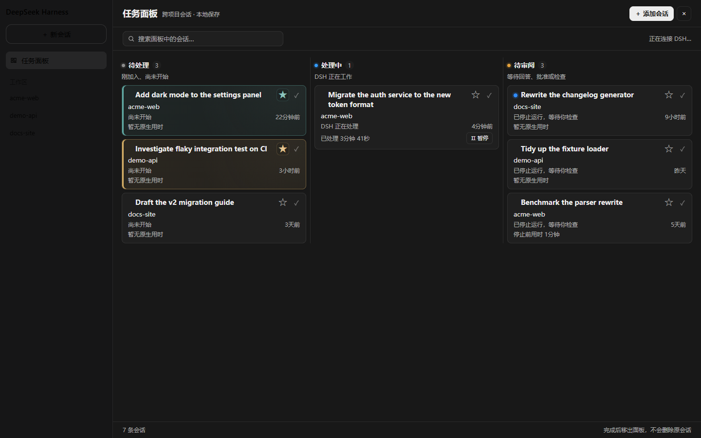

# dsh-codex-task-board

A cross-project **task board** for [DeepSeek Harness](https://github.com/deepseek-ai/deepseek-harness) — every DSH session becomes a task card, grouped into three columns: **待处理 / 处理中 / 待审阅** (To do / In progress / Needs review).

English | [中文](#中文说明)



> The screenshot above is rendered from the real bundle against **fictional demo data** (`npm run preview`). Nothing in this repo contains a maintainer's workspace names, paths or session titles.

## What it does

The board is a first-class DSH destination, not an overlay: it registers into the shell's own global-panel seats (`sidebar.panellist` + `main`), the same mechanism DSH's built-in Schedules page uses. Selecting it swaps the centre column; returning to the Conversation does not change the current session.

- **Three columns** derived from live host facts — `running`, `completed` (finished but not yet opened), and unanswered interactions.
- **Priority stars** with a 16-colour palette. A colour is assigned **once** and remembered, so it survives filtering, sorting, unstarring, and even removing the card.
- **Stable "In progress" ordering** — progress, timestamps, titles and stars never reorder the column; new arrivals append at the end.
- **One-page adaptive layout** — busy columns gain horizontal lanes instead of shrinking text. Font size is never reduced and no card detail is ever hidden.
- **Native turn duration** folded from the session's own `turn/start` → `turn/end` events.
- **Add-session picker**, panel search, pause/resume, complete-with-undo.
- **Light and dark**, following the shell's resolved colour scheme.

## Install

Install straight from GitHub — this is the supported path, and the only one that works today (the package is not on npm yet):

```sh
dsh plugin --profile <your-profile> add git+https://github.com/cpsGGG/dsh-codex-task-board.git
```

Then restart DSH and open **任务面板** at the bottom of the sidebar.

<details>
<summary>Other ways to install</summary>

**From a local clone** (best if you want to edit the source):

```sh
git clone https://github.com/cpsGGG/dsh-codex-task-board.git
dsh plugin --profile <your-profile> add ./dsh-codex-task-board
```

**Pinned to a tag or commit** — recommended once versions are tagged, so an
upstream change cannot surprise you:

```sh
dsh plugin --profile <your-profile> add git+https://github.com/cpsGGG/dsh-codex-task-board.git#v1.0.0
```

`lib/client.js` is committed, so **no build step and no install scripts run** —
the package deliberately ships no `prepare` script, which is what would
otherwise trip pnpm's `allowBuilds` prompt on a git install. If you change
`src/`, run `npm run build` and re-install.

> **Windows note:** pnpm installs `file:` dependencies as a *copy*, not a
> symlink. When developing against a local checkout, point the profile's
> `node_modules/dsh-codex-task-board` at your working tree with a directory
> junction instead, or re-run the install after every build.

</details>

## Requirements

| | |
|---|---|
| DSH | `0.2.0-rc.2` (developed and verified against it) |
| Profile | any `web`-platform profile |
| Node | ≥ 20 (build and tests only — the shipped bundle needs none) |

DSH is in developer preview and its internal slot surface can change between releases. The plugin reads `useSessions` from the global standard props and registers into `sidebar.panellist` + `main`; if a future release renames either, the board fails loudly with a visible stack rather than silently disappearing.

## How it works

DSH has no DOM to patch — it has slots. So this is a native plugin rather than an injection:

| Concern | Approach |
|---|---|
| Sidebar entry | `sidebar.panellist` list slot (`id: task-board`) |
| Panel body | `main` keyed slot, dispatched by that same id |
| Navigation | `ctx.layout.selectPanel(id)` / `selectPanel(null)` |
| Session data | the `useSessions` global standard prop |
| Turn duration | `ctx.sessions.binding(id).eventSource` folded over `turn/start` / `turn/end` |
| Pause / resume | `ISession.cancel()` / `ISession.prompt()` |
| Persistence | `localStorage`, key `codex-task-board:session-state:v3` |

`src/core.mjs` is deliberately framework-free — no DOM, no React, no Cordis — so every rule (status precedence, ordering, layout arithmetic, colour balancing) is unit-testable in plain Node.

### Layout of the repo

| Path | |
|---|---|
| `src/core.mjs` | Pure logic: palette, status, ordering, adaptive layout, store normalisation |
| `src/client.mjs` | Panel UI + slot registration |
| `src/panel.css` | Stylesheet |
| `lib/client.js` | Built bundle (committed) |
| `tests/core.test.mjs` | 34 logic tests |
| `tests/panel.test.mjs` | 16 render tests that execute the **real built bundle** |
| `tools/build.mjs` | Build |
| `tools/make-preview.mjs` | Generates `preview/board.html` from demo data |
| `tools/*asar*.mjs`, `tools/*slots*.mjs` | Introspection helpers for a DSH `app.asar` |

## Development

```sh
npm run build     # src/*.mjs + panel.css -> lib/client.js
npm test          # 50 tests
npm run preview   # regenerate preview/board.html
```

The client half is not an ES module. DSH's client module system loads a classic script that calls `window.__ModuleLoader__.load({ id, factory })` and resolves externals through an injected `require`. `tools/build.mjs` inlines the two local modules, rewrites the `react` import into that `require`, and wraps the result — no bundler, because the graph is two files.

The render tests are worth knowing about: they load `lib/client.js`, drive the same `apply()` the shell drives, and expand the returned element tree with a stub React. That catches the class of failure a live check hides behind DSH's slot error boundary, which renders an opaque empty `div`.

### Why the preview exists

A screenshot of a real board leaks whatever the maintainer had open. `tools/make-preview.mjs` renders the same component against a fixed cast of fictional sessions, so the artifact is reproducible and safe to publish.

## Differences from the original Codex panel

This is a port of a private Codex panel (`codex-task-board-mod@0.5.8`) that injected DOM into the Codex desktop app. Two behaviours had to change because DSH's session model differs:

1. **"Resume" sends a real message.** The original sent `thread/resume` plus an *empty* `turn/start` — "continue without appending a user message". DSH has no such verb: `prompt` rejects content with no non-whitespace text (the gateway's `hasPromptContent` guard), and there is no session-level resume. This port therefore sends a minimal real instruction (`继续`). The card leaves the paused state and starts running exactly as before; the difference is that the message is visible in the transcript.

2. **Blank sessions stay off the board.** DSH reuses one empty "New session" draft per workspace, so it is excluded — the same reason the original skipped `thread.ephemeral` threads.

Everything else — the three columns and their copy, card anatomy, the 16-colour palette and its least-used balancing, the status precedence, the stable ordering, the adaptive layout arithmetic, the interactions and the store schema — is reproduced from the original.

## Contributing

Issues and PRs welcome. Please run `npm test` before opening a PR; if you touch the panel UI, also run `npm run preview` and check both themes.

## License

[MIT](LICENSE).

This project is not affiliated with DeepSeek AI or OpenAI. "DeepSeek Harness" and "Codex" are the property of their respective owners.

---

## 中文说明

一个 **跨项目任务面板**：把每条 DSH 会话变成一张任务卡片，按 **待处理 / 处理中 / 待审阅** 三栏集中查看与打开。

面板是 DSH 的**原生目的地**，不是浮层——它注册进外壳自己的全局面板槽位（`sidebar.panellist` + `main`），和 DSH 内置的「自动化任务」页用的是同一套机制。点它切换中央面板，返回会话不改变当前会话。

### 功能

- **三栏**由宿主真实状态推导：运行中、已完成但未打开、等待回答。
- **优先级星标**：16 色色板，颜色**只分配一次**并记住——筛选、排序、取消星标、甚至移出面板后重新加入，都恢复原色。
- **「处理中」顺序稳定**：进度、时间、标题、星标都不触发重排，新进入的追加到末尾。
- **单页自适应**：繁忙的列增加横向分栏，而不是缩小文字；字号永不压缩，卡片信息永不隐藏。
- **原生用时**：从会话自身的 `turn/start` → `turn/end` 事件折算。
- **添加会话**弹窗、面板搜索、暂停/启动、完成并撤销。
- **浅色 / 深色**跟随外壳解析出的配色。

### 安装

从 GitHub 直接安装（当前唯一可用方式，包尚未发布到 npm）：

```sh
dsh plugin --profile <你的 profile> add git+https://github.com/cpsGGG/dsh-codex-task-board.git
```

然后重启 DSH，点侧边栏底部的 **任务面板**。

也可以先 `git clone` 再 `add ./dsh-codex-task-board`，或锁定到某个 tag/commit：
`add git+https://github.com/cpsGGG/dsh-codex-task-board.git#v1.0.0`。

`lib/client.js` 已随仓库提交，**无需构建、也不会执行任何安装脚本**——本包刻意不提供 `prepare`，否则 git 安装会触发 pnpm 的 `allowBuilds` 提示。改动 `src/` 后运行 `npm run build` 并重新安装。

> **Windows 提示**：pnpm 对 `file:` 依赖是**复制**而非软链。若你在本地 checkout 上开发，建议把 profile 的 `node_modules/dsh-codex-task-board` 用目录联接指向工作目录，否则每次构建后都要重装。

### 与原始 Codex 面板的两处差异

1. **「启动」发送真实消息**。原版发 `thread/resume` + **空的** `turn/start`（"不追加用户消息地继续"）。DSH 没有这个动词：`prompt` 拒绝没有非空白文本的内容，也没有会话级 resume。因此这里发送一条最小真实指令（`继续`）——卡片同样离开暂停态并开始运行，区别只是该消息在对话记录里可见。

2. **空会话不入面板**。DSH 每个工作区复用一个空的「新会话」草稿，故排除；原版对应的是跳过 `thread.ephemeral`。

其余部分（三栏与文案、卡片结构、16 色色板与"最少使用"平衡、状态判定优先级、稳定排序、自适应布局算法、交互、存储结构）均照原版复刻。

### 开发

```sh
npm run build     # src/*.mjs + panel.css -> lib/client.js
npm test          # 50 个测试
npm run preview   # 重新生成 preview/board.html
```

客户端半边不是 ES module：DSH 的客户端模块系统加载的是调用 `window.__ModuleLoader__.load({ id, factory })` 的经典脚本，外部依赖通过注入的 `require` 解析。`tools/build.mjs` 内联两个本地模块、把 `react` 改写成该 `require`，再包上外壳——没有引入打包器，因为依赖图只有两个文件。

渲染测试值得一提：它加载 `lib/client.js`，走与外壳相同的 `apply()`，用桩 React 展开元素树。这能抓住一类被 DSH 槽位错误边界（只渲染一个空的 `data-slot-error`）掩盖的崩溃。

### 许可

[MIT](LICENSE)。本项目与 DeepSeek AI、OpenAI 均无隶属关系。
